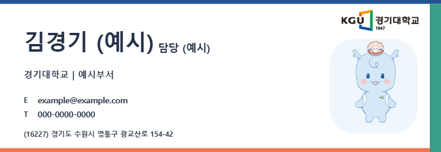
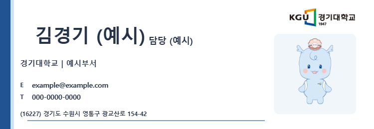
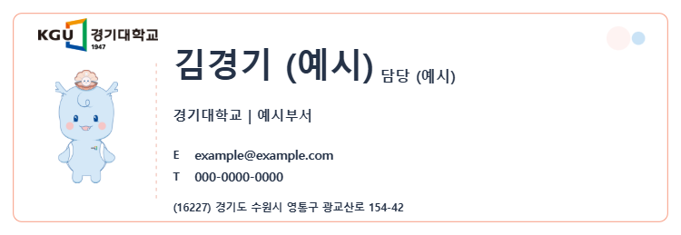

# Verification — 2026-10-26

Base: `ff8543d130bc756819c73aaa88b62366210d682a` (fresh remote clone).
No repository `AGENTS.md`, `.agents/skills`, or checked-in `.github/workflows` exists at this base.

## Deployment boundary

GitHub run [40271004240](https://github.com/erakeun/mail-card-maker/actions/runs/40271004240) is `pages build and deployment`, `dynamic/pages/pages-build-deployment`, main, success, at ff8543d1. It began three seconds after PR #7's merge commit. Main merge triggers production Pages deployment. This change is prepared on a separate branch and draft PR; no merge, main push, deployment-settings change, backend change, or new repository is authorized/performed.

## Executed checks

`tests/kyonggi-smoke.cjs`: 15 checks passed, zero browser JavaScript errors.

- Official KGU default logo and Suwon address.
- All four design screens inspected; actual 750px PNG downloads reopened in browser with decoded width asserted.
- Long fictional name and department render with existing shrink/overflow handling.
- Seoul selection fills the official address; manual room suffix survives reload.
- Font, color, campus and address restore after reload; downloaded JSON restores edits.
- Logo/character on/off combinations and all six official images load.
- No Hanyang character/logo, Google Analytics, or legacy feedback requests.
- Hanyang localStorage key unchanged; Hanyang-format file rejected without replacing current work.
- Position/scale adjustments and 5000px PNG download/reopen.
- Uploaded photo/custom logo embedded and restored.
- Mobile 390px layout has no horizontal overflow.

`tests/dot-smoke.cjs`: existing Hanyang suite, 17 checks passed. Includes 7 templates/98 ordinary characters, 65 dot poses, lazy thumbnails, pixel ratio/flip, 750px and 5000px exports, JSON restore, rapid selection, immediate tab close and process restart recovery, photo/logo embedding, stale-upload prevention and invalid/legacy draft handling.

`git diff --exit-code HEAD -- index.html card-templates.js dot-characters.js dot-picker.js draft-storage.js assets tests/dot-smoke.cjs`: clean. Existing production source is byte-for-byte unchanged.

Headless Chrome used only dedicated automation contexts/profile; no physical mouse, existing browser session, or whole-browser termination. External network requests were aborted during smoke tests; system font fallback was exercised. Pretendard CDN loading in production is not established by the offline tests.

## Review images

Full UI, long-text, mobile and downloaded-image evidence is retained locally under `test-results/kyonggi/`; machine-readable reports are `test-results/kyonggi/report.json` and `test-results/mail-test-report.json`.
